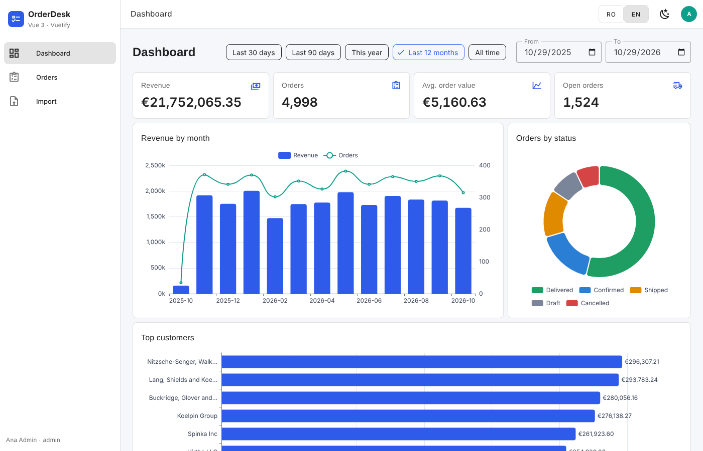
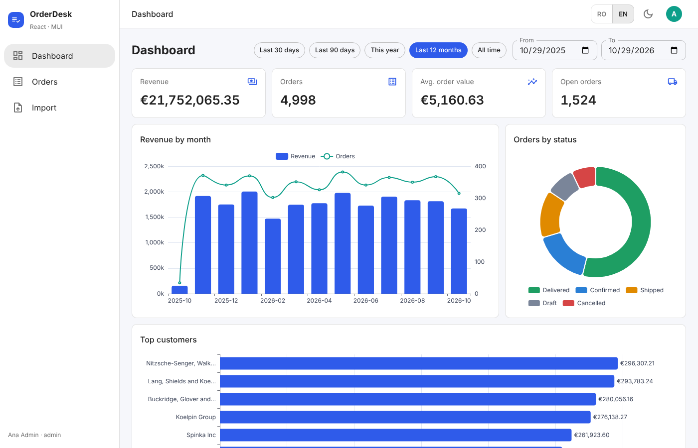
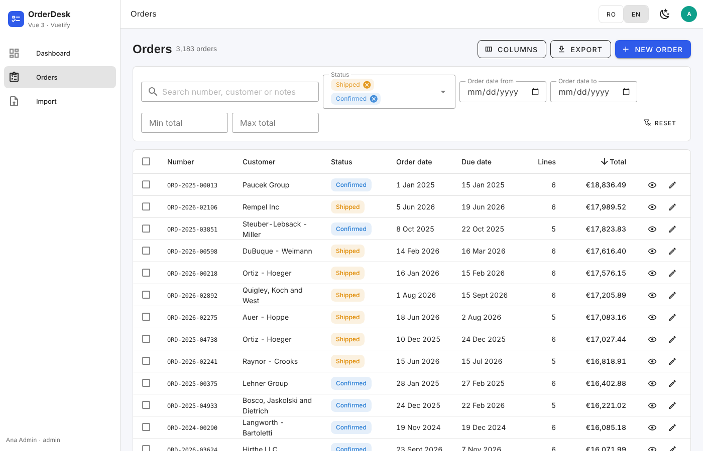
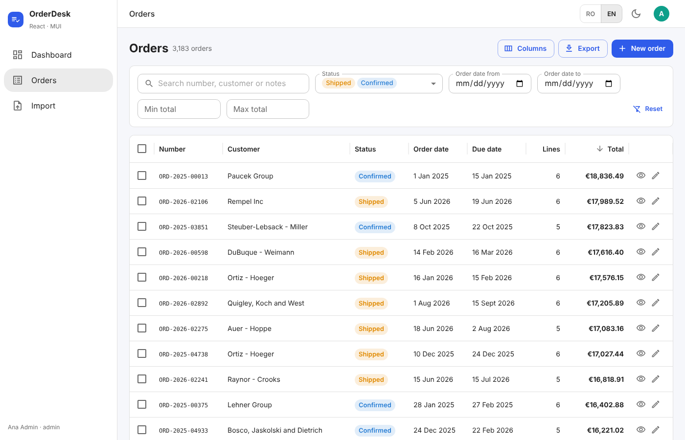
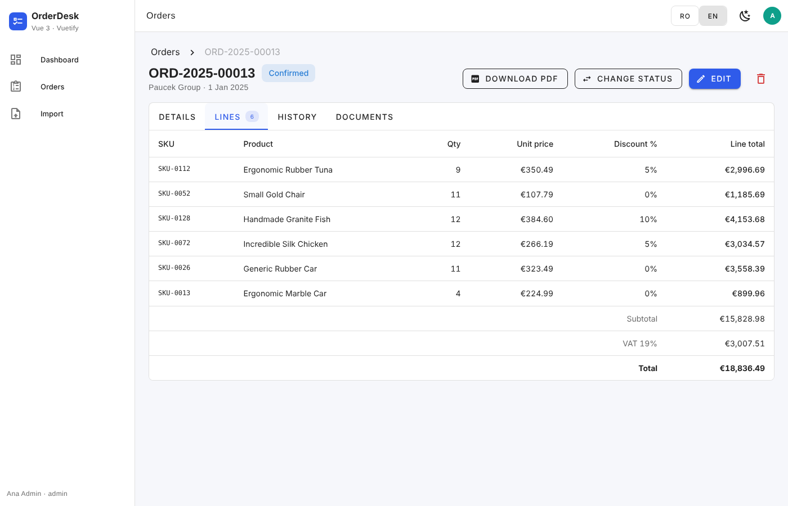
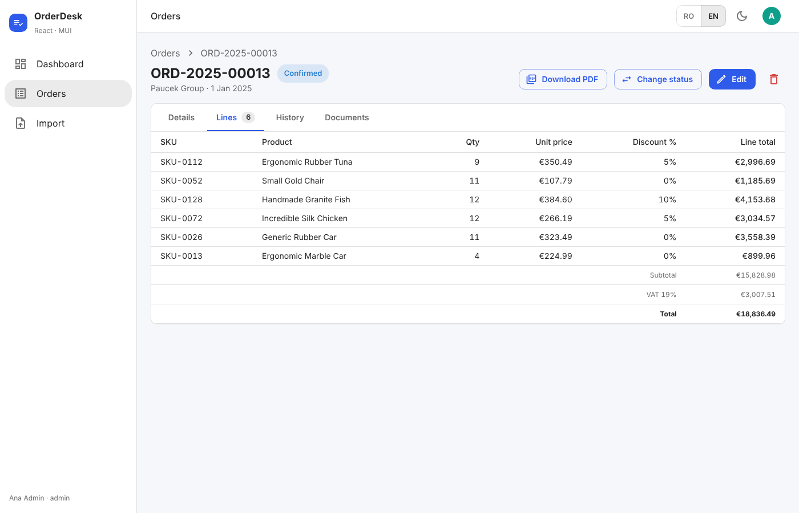
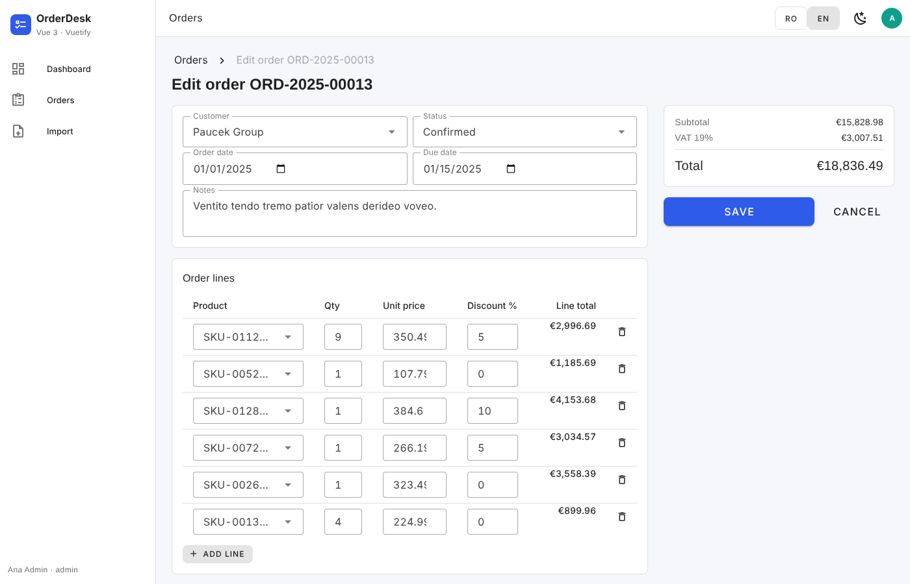
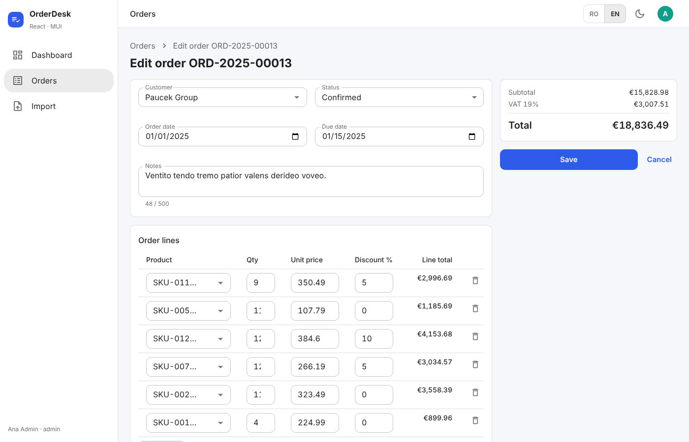

# OrderDesk

[](https://github.com/ioanscurtu10/orderdesk/actions/workflows/ci.yml)

B2B order management, built twice on the same mock API: once in **Vue 3 + Vuetify**, once in **React + MUI**. Same design, same features, same end-to-end test suite. The point of the repository is to show production-style front-end work on the kind of screens business users live in all day: dashboards, data grids with thousands of rows, forms with dynamic lines, imports, exports.

**Live demo:** [Vue app](https://orderdesk-vue.vercel.app) · [React app](https://orderdesk-react.vercel.app). Sign in with one of the demo accounts shown on the login screen. The API runs on a free Render instance that an uptime monitor keeps awake; if it does fall asleep, the first request can take up to a minute. The data is shared by all visitors and resets every hour.

| Vue 3 · Vuetify                                            | React 19 · MUI                                                 |
| ---------------------------------------------------------- | -------------------------------------------------------------- |
|        |        |
|         |         |
|  |  |
|      |      |

Dark mode, both apps: [Vue](docs/screenshots/vue-dashboard-dark.png) · [React](docs/screenshots/react-dashboard-dark.png)

## Features

- **Authentication and roles**: signed tokens with expiry, `admin` and `viewer` roles, route guards, a 403 page, automatic sign-out with a notice when the API answers 401.
- **Dashboard**: four KPIs and three charts (revenue by month, orders by status, top customers) driven by a date range with presets; "last 12 months" starts on the first day of a month, so the chart never opens with a partial month.
- **Orders grid** on 10,000 seeded orders: server-side paging, sorting and filtering (text search, multi-status, date range, total range), column visibility remembered in the browser, multi-select with an optimistic bulk status change and bulk delete, and grid state kept in the URL so a view can be shared by link.
- **Order form**: customer and product autocompletes backed by the API, async validation (the customer must exist), dynamic lines with live totals, zod validation shared with the server, and an "unsaved changes" guard for both in-app navigation and browser close.
- **Order detail**: tabs for details, lines, history timeline and documents; status change; PDF invoice generated in the browser.
- **Import**: downloadable CSV template, client-side preview with per-row errors, grouping of lines into orders, then a server-side import that reports what was created and what was skipped.
- **Export**: CSV generated by the server for the current filter; XLSX built in the browser from the same filtered rows, or only from the selected ones.
- **UX states**: skeletons, empty and error states with retry, toasts, confirm dialogs, responsive down to 360 px phones with a collapsible navigation drawer, light and dark theme, Romanian and English.

## Stack

| Layer        | Vue app                                   | React app                       |
| ------------ | ----------------------------------------- | ------------------------------- |
| Build        | Vite 7, TypeScript 5 strict               | Vite 7, TypeScript 5 strict     |
| UI           | Vuetify 3 (`v-data-table-server`)         | MUI 7 + MUI X Data Grid 8       |
| Routing      | Vue Router 4                              | React Router 7                  |
| Server state | Pinia store that discards stale responses | TanStack Query 5                |
| Client state | Pinia                                     | Zustand 5                       |
| Forms        | Vuetify rules + zod on submit             | React Hook Form + zod resolver  |
| Charts       | ECharts 6 via vue-echarts                 | ECharts 6 via echarts-for-react |
| i18n         | vue-i18n                                  | i18next                         |
| Unit tests   | Vitest 4 + Vue Test Utils                 | Vitest 4 + Testing Library      |

Shared by both: `packages/shared` (types, zod schemas, the filter/sort/paginate logic, totals, dashboard date presets, CSV helpers, design tokens, translation files), `packages/api` (Express 5 mock server) and `e2e` (Playwright).

## Getting started

Requires Node.js 22 (see `.nvmrc`).

```bash
npm install
npm run dev          # API on :4000, Vue on :5173, React on :5174
```

Sign in with one of the demo accounts shown on the login screen:

| Account                | Password    | Role        |
| ---------------------- | ----------- | ----------- |
| `admin@orderdesk.dev`  | `admin123`  | full access |
| `viewer@orderdesk.dev` | `viewer123` | read-only   |

Other scripts:

```bash
npm run test          # unit tests, all packages
npm run test:e2e      # Playwright, both apps (starts the servers itself)
npm run lint          # ESLint (TS, Vue, React hooks)
npm run format:check  # Prettier
npm run typecheck     # tsc / vue-tsc, all packages
npm run build         # production builds of both apps
npm run ci            # lint, typecheck, unit tests and build in one go
npm run screenshots   # regenerates docs/screenshots (needs `npm run dev` running)
```

## Architecture

```
orderdesk/
├─ packages/
│  ├─ shared/        domain types, zod schemas, pure query logic, totals, presets, CSV, i18n, tokens
│  │  └─ src/browser  download, XLSX and PDF helpers (browser only, lazy-loaded)
│  └─ api/           Express 5 mock API, deterministic faker dataset, signed tokens
├─ apps/
│  ├─ vue/           Vue 3 + Vuetify implementation (vercel.json for deployment)
│  └─ react/         React + MUI implementation (vercel.json for deployment)
├─ e2e/              Playwright suite, parameterised by framework
├─ .github/          CI: lint, format check, typecheck, unit tests, build, e2e
└─ render.yaml       Render Blueprint for the API
```

```
Development:  browser --> Vite dev server --(/api proxy)----> Express API
Production:   browser --> static app on Vercel --(VITE_API_URL)--> Express API on Render

Express API (packages/api)
  in-memory Store, seeded with faker
  queryOrders(), computeTotals(), validateImportRows()
    come from packages/shared: the same code the UIs and the unit tests run
```

The API is intentionally in-memory and re-seeded on start (`faker.seed(42)`, 10,000 orders in ~300 ms). It behaves like a real backend where it matters for the front-end: pagination metadata, validation errors with paths, 401/403, artificial latency so loading states are visible, and a CSV export with a BOM so Excel shows diacritics correctly.

## Decisions

**Server-side grid.** 10,000 rows is small enough to sort in the browser, but real order books are not, so the grid asks the server for one page at a time. The same `queryOrders()` function from `packages/shared` runs on the server and in unit tests, which keeps the filter semantics in one place.

**The URL is the grid's state.** Page, sort, filters and search all live in the query string. Sharing a link reproduces the exact view, the browser back button works, and neither app needs a "grid state" store. Debounced inputs keep typing from spamming the router.

**TanStack Query in React, Pinia in Vue.** The React app uses TanStack Query for caching, `keepPreviousData` (no flicker between pages) and an optimistic mutation for bulk status changes that cancels in-flight refetches and rolls back on error. The Vue app reaches the same behaviour with a Pinia store: a request counter discards out-of-order responses, and the bulk status change is optimistic with a rollback snapshot. The Vue version is deliberately dependency-light; TanStack Query also ships for Vue if a project wants the richer cache.

**zod on both sides.** `orderInputSchema` validates in the browser (React Hook Form resolver, Vuetify rules plus a submit-time parse) and again in Express. Error messages are translation keys, so the same issue renders in Romanian or English wherever it surfaces.

**Shared translation files with single-brace placeholders.** vue-i18n and i18next disagree on interpolation syntax, so i18next is configured with `{name}` instead of `{{name}}` and one JSON file per language serves both apps.

**Heavy libraries load on first use.** The XLSX writer (write-excel-file, ~70 kB) and jsPDF (~380 kB) are `import()`ed when the user clicks Export XLSX or Download PDF, never with the page. Route components are code-split in both apps.

**Expired tokens.** The axios interceptor turns any 401 into a logout with reason `expired`; the route guard then redirects to login remembering the original URL, and the login page shows a notice. The login page itself never navigates: the guard does, which avoids a race between the store update and the redirect.

**Design tokens, not two designs.** Colours, status palette, chart palette and the font live in `packages/shared/src/theme.ts`. The Vuetify theme and the MUI theme are both derived from them, which is why the two apps look like one product.

## Testing

- **Unit** (`npm run test`): 53 tests. Shared logic (filtering, sorting, paging, URL round-trip, totals, schemas, CSV escaping, dashboard date presets), the API through supertest (auth, roles, validation, CRUD, bulk, import, CSV export, dashboard), and component tests for the login flow and status chip in each app.
- **End-to-end** (`npm run test:e2e`): 24 scenarios run against each app, plus a mobile layout check on a phone viewport for each, so 50 runs in total. They cover sign-in and redirects, role restrictions, expired tokens, grid filters from the UI and from a pasted URL, column visibility persistence, bulk status change, creating and editing orders with validation, the unsaved-changes guard, CSV and XLSX export, PDF download, CSV import with error reporting, and the language switch. Framework-specific selectors are isolated in `e2e/tests/fixtures.ts`; the scenarios are written once.

## Importing orders

Download the template from the Import page or build a CSV with these columns:

```
ref,customerCode,status,orderDate,dueDate,sku,quantity,unitPrice,discountPct,notes
```

One row per order line. Rows with the same `ref` become one order. Customer codes are `CUST-001` … `CUST-200`, SKUs are `SKU-0001` … `SKU-0150`, statuses are `draft`, `confirmed`, `shipped`, `delivered`, `cancelled`.

## Configuration

| Variable              | Where | Default                 | Purpose                            |
| --------------------- | ----- | ----------------------- | ---------------------------------- |
| `PORT`                | api   | `4000`                  | API port                           |
| `API_DELAY_MS`        | api   | `150`                   | artificial latency (`0` in tests)  |
| `ORDER_COUNT`         | api   | `10000`                 | number of seeded orders            |
| `CUSTOMER_COUNT`      | api   | `200`                   | number of seeded customers         |
| `PRODUCT_COUNT`       | api   | `150`                   | number of seeded products          |
| `SEED`                | api   | `42`                    | faker seed for the dataset         |
| `TOKEN_TTL_MS`        | api   | 8 h                     | token lifetime                     |
| `TOKEN_SECRET`        | api   | demo value              | secret that signs the tokens       |
| `RESET_EVERY_MINUTES` | api   | `0` (never)             | reseed the dataset on a schedule   |
| `VITE_API_URL`        | apps  | `/api`                  | API base URL for production builds |
| `VITE_API_PROXY`      | apps  | `http://localhost:4000` | dev-server proxy target            |

## Deploying

Both apps are static: `npm run build` produces `apps/vue/dist` and `apps/react/dist`. Serve them from any static host with `VITE_API_URL` pointing at the API, and configure SPA fallback (`/* → index.html`). The API runs with `npm run start -w @orderdesk/api` (tsx, no build step).

The repository is ready for the setup used by the live demo, both on free plans:

- **API on Render.** `render.yaml` is a Blueprint: in the Render dashboard choose _New → Blueprint_ and select the repository. It installs from the root, starts the API, generates `TOKEN_SECRET` and reseeds the data every hour. Free instances sleep after 15 minutes without traffic; an uptime monitor calling `/api/health` every 10 minutes keeps it awake.
- **Apps on Vercel.** Import the repository twice, once with _Root Directory_ `apps/vue` and once with `apps/react`. Each folder has a `vercel.json` that installs the workspace from the root, builds the app and adds the SPA fallback. Set `VITE_API_URL` to the Render URL followed by `/api`, for example `https://orderdesk-api.onrender.com/api`. The API allows cross-origin requests, so no proxy is needed.

## License

MIT, see [LICENSE](LICENSE).
